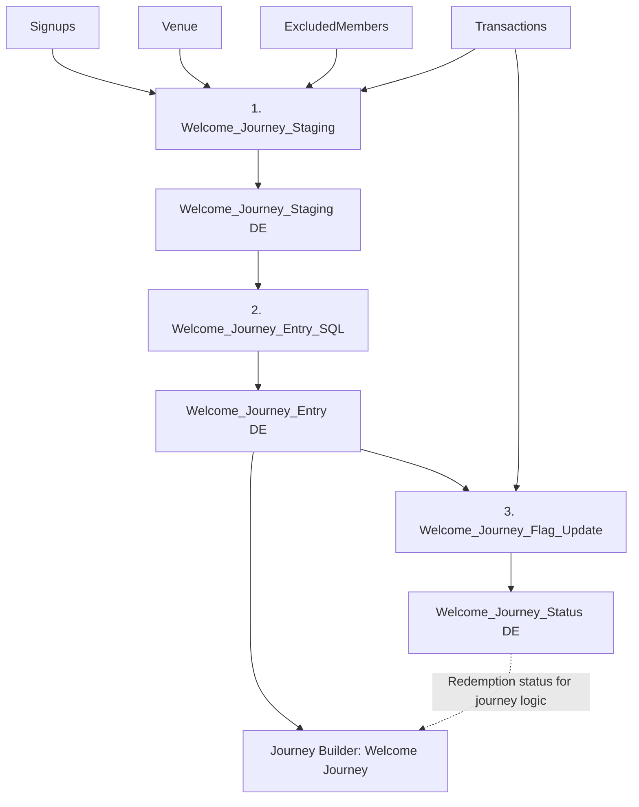

Tavern Group | SQL-Powered Welcome Journey

A Salesforce Marketing Cloud (SFMC) SQL capstone demonstrating how an always-on welcome audience can be qualified, prepared, and monitored through SQL Query Activities, Automation Studio, Data Extensions, and Journey Builder.
Project type: Fictional training/portfolio capstone. The automation was tested and the welcome journey was configured, but the journey was not activated for live sending. No production campaign metrics are claimed.

Business scenario
The Tavern Group operates multiple hospitality venues with registrations from kiosks, web, and an app. The proposed solution qualifies newly registered rewards members for a venue-based welcome journey and tracks whether their welcome coupon has been redeemed.

Journey goal: Introduce each eligible member to their registered venue and encourage coupon redemption within 14 days of signup.
Planned communication	Timing	Purpose
Welcome email (E1)	Within 1 day	Introduce the member's registered venue
Educational email (E2)	Day 3	Introduce the venue's events and activities
Offer email (E3)	Day 7	Present the welcome coupon
Conditional reminder (E4)	Day 14 if not redeemed	Remind members with unused coupons

Audience qualification
The staging query selects members who have opted into marketing email, signed up within the previous 24 hours, are 21 or older, and registered with an active venue. It excludes addresses in ExcludedMembers, staff email addresses, and MemberIDs already present in Welcome_Journey_Entry.

It generates the coupon code in the form WELCOME-<MemberID> and an initial HasRedeemed flag.
Solution architecture

The dashed connection represents intended use of redemption status by the journey; it does not assert that a production data relationship or live send was validated.
SQL Query Activities
The SQL files below preserve the submitted query statements and comments. The file names match their activity names in Automation Studio.
Step	Activity / SQL file	Target Data Extension	Function
1	[`Welcome_Journey_Staging.sql`](sql/Welcome_Journey_Staging.sql)	Welcome_Journey_Staging	Qualify eligible new members and prepare calculated fields
2	[`Welcome_Journey_Entry_SQL.sql`](sql/Welcome_Journey_Entry_SQL.sql)	Welcome_Journey_Entry	Transfer qualified records from staging
3	[`Welcome_Journey_Flag_Update.sql`](sql/Welcome_Journey_Flag_Update.sql)	Welcome_Journey_Status	Check matching redeemed welcome coupons and output status

SQL features: EXISTS, NOT EXISTS, CASE, DATEDIFF, DATEADD, GETDATE, CONCAT, date filtering, and correlated subqueries.
Automation Studio workflow

The three SQL Query Activities are ordered as staging → journey entry → flag/status update.
Journey Builder configuration

The configured canvas includes the four-email sequence, wait activities, and a redemption-based decision split before the optional reminder. The screenshot shows the journey was not yet scheduled, and it was not activated for live sending.

Decision-split screenshot captured from the accompanying portfolio page; the original SFMC journey canvas above is a higher-resolution source image.
Execution history and testing

The submitted run log shows three completed runs and one earlier failed run during testing (75% completed / 25% failed for the four recorded attempts). These are execution statuses, not email delivery or campaign performance figures.

The staging query uses a moving 24-hour signup window. A subsequent empty staging Data Extension therefore does not by itself establish that the workflow failed. No live send, coupon redemption uplift, or revenue outcome is claimed.

Tools and technologies
Salesforce Marketing Cloud · SQL Query Activities · Automation Studio · Journey Builder · Data Extensions · SQL
Project status
Training implementation: SQL workflow configured and tested; Journey Builder configured but not activated. These scripts are shared as an educational case study, not as independently production-validated SQL.
